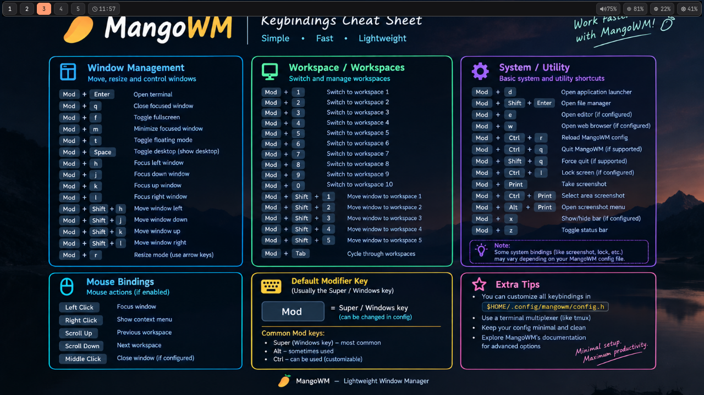

# Waybar Themes

Waybar configurations and themes for Linux desktops. The current featured
release is **V1.1**, a compact Waybar setup built for **Arch Linux + MangoWM**.

## V1.1 preview



The preview shows the slim top bar with workspace indicators, a clock, and
compact status modules. The bar's active-window title is centered when a window
is focused.

## V1.1 features

- Slim top bar with three groups: workspaces and clock on the left, active
  window title centered on screen, and system controls on the right.
- Rounded charcoal module backgrounds, muted text, subtle borders and shadow,
  and a restrained orange active-workspace highlight.
- MangoWM workspace status and switching using `mmsg`; active-window status
  comes from MangoWM IPC. Long titles are truncated in the bar and retained in
  the tooltip.
- Native Waybar clock, PulseAudio-compatible volume, memory, and CPU modules.
- Hardware brightness detection for supported kernel backlights and compatible
  DDC/CI monitors. Unsupported or unavailable controls are reported honestly;
  software gamma is not used as a substitute.
- No Bluetooth module and no Hyprland-specific modules or commands.
- Interactive Arch installer with dry-run, backups, confirmation before
  package/configuration changes, and a cautious rollback script.

## Install V1.1

Review the full [V1.1 installation guide](V1.1/README.md) for dependencies,
permissions, troubleshooting, and hardware limitations. On Arch Linux or an
Arch-based system, clone this repository and run:

```sh
git clone https://github.com/code-smith404/Waybar-Themes.git
cd Waybar-Themes/V1.1
./install.sh --dry-run
./install.sh
```

The installer checks the platform and dependencies, asks before installing
packages or replacing managed Waybar files, and backs up existing files. It
does not change privileged settings automatically. To roll back the managed
configuration, run `./uninstall.sh` from `V1.1/`; files changed after
installation are preserved rather than overwritten.

## V1.1 files

| File | Purpose |
| --- | --- |
| [`config.jsonc`](V1.1/config.jsonc) | Waybar layout, modules, interactions, and update intervals |
| [`style.css`](V1.1/style.css) | Compact charcoal theme styling |
| [`scripts/mango-tags`](V1.1/scripts/mango-tags) | MangoWM workspace status for Waybar |
| [`scripts/mango-title`](V1.1/scripts/mango-title) | Centered active-window title with clean empty/unavailable states |
| [`scripts/brightness-control`](V1.1/scripts/brightness-control) | Runtime backlight/DDC/CI detection and brightness controls |
| [`scripts/mango-current-tags`](V1.1/scripts/mango-current-tags), [`scripts/mango-layout`](V1.1/scripts/mango-layout) | Additional MangoWM helpers retained in the repository; not used by the active V1.1 Waybar configuration |
| [`install.sh`](V1.1/install.sh) | Interactive Arch installation with dry-run support |
| [`uninstall.sh`](V1.1/uninstall.sh) | Guarded rollback of installer-managed files |
| [`README.md`](V1.1/README.md) | Detailed dependencies, setup, permissions, and troubleshooting |
| [`preview.png`](V1.1/preview.png) | Screenshot preview shown above |
| [`config.jsonc.bak`](V1.1/config.jsonc.bak), [`style.css.bak`](V1.1/style.css.bak) | Preserved originals of the V1.1 configuration and stylesheet |

## Requirements and compatibility

V1.1 targets Waybar running in a MangoWM session on Arch Linux or an Arch-based
distribution. It requires MangoWM's `mmsg`, `jq`, Waybar, and a PulseAudio-
compatible audio server for volume control. JetBrainsMono Nerd Font and Font
Awesome provide the intended typography and icons. `brightnessctl` supports
kernel backlight devices; `ddcutil` is optional and only helps when the monitor,
graphics driver, and device permissions expose DDC/CI brightness control.

Brightness availability depends on the actual display hardware and drivers.
Some DDC/CI displays allow reading brightness but reject writes. The installer
does not claim or simulate support in those cases. See the
[V1.1 guide](V1.1/README.md#brightness-permissions-and-limits) for setup and
troubleshooting details.
